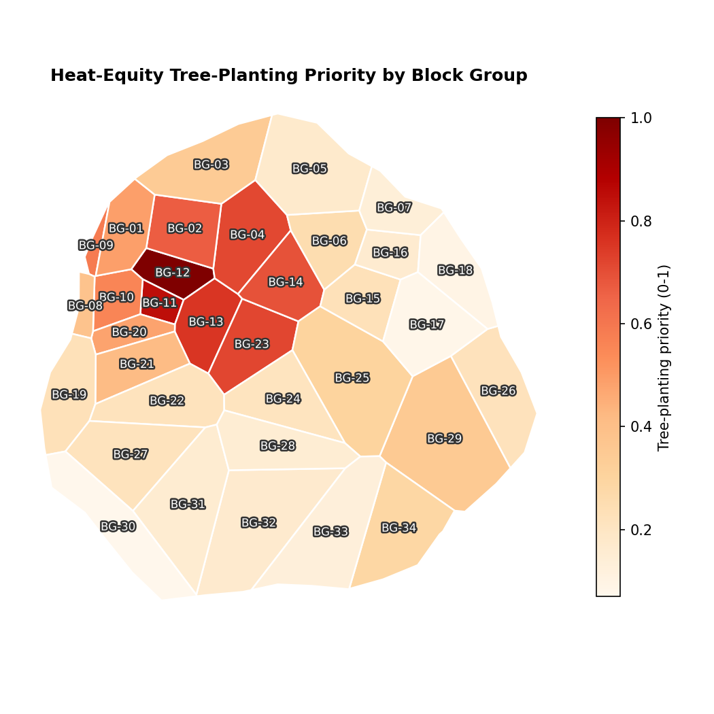

# GISPR Module 8 - End-to-End Workflows and GDAL

A heat-equity tree-planting pipeline (raster + vector + zonal stats + ranking + maps), a GDAL command-line log, and a reusable restoration-priority pipeline for WRIA 8.

$\color{darkred}{\textbf{Note! Self Check Questions and Extra credit sections 1 + 2 are located within Notebook .ipynb}}$

## View it
- [Full notebook with working maps](https://jdoit0611.github.io/gispr-module8/GISPR_Module8_EndToEndWorkflows.html)
- [Interactive priority map (folium)](https://jdoit0611.github.io/gispr-module8/output/priority_map_interactive.html)

## Priority map

